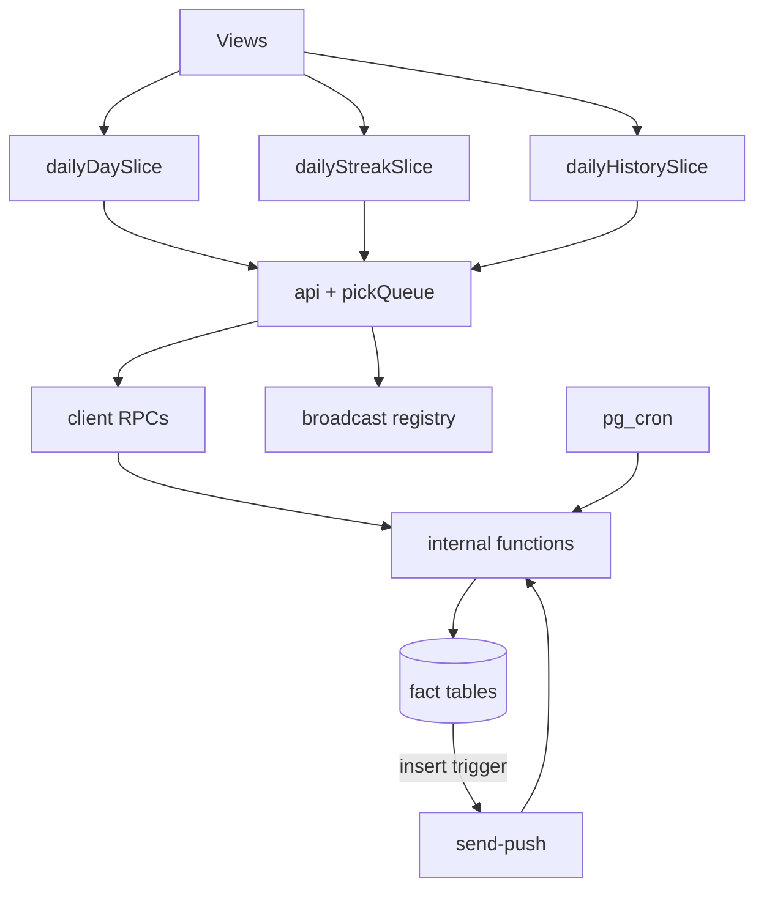
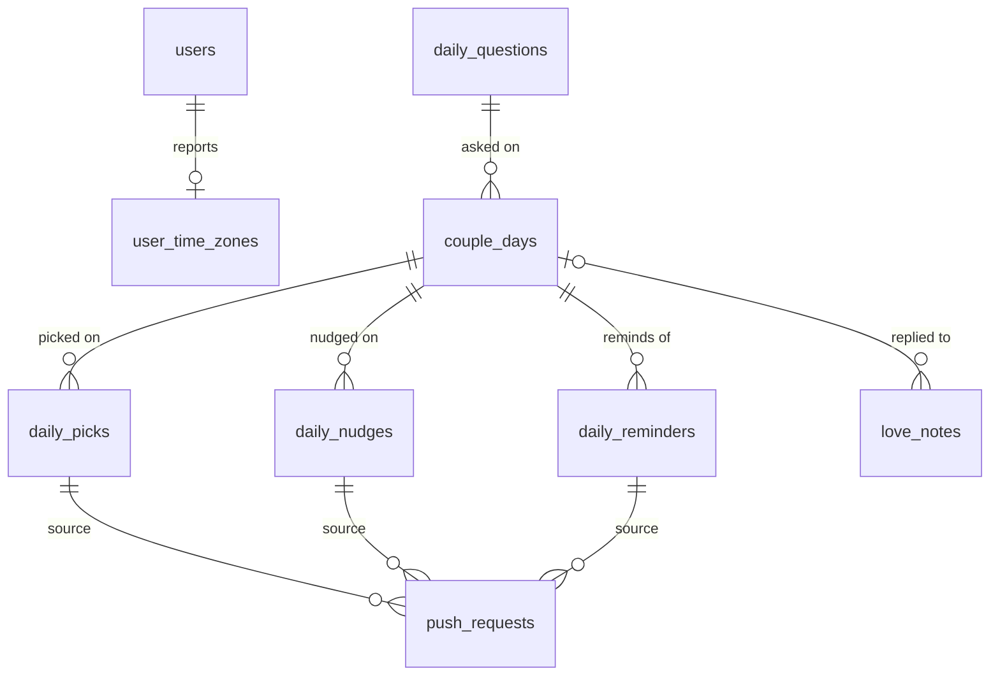
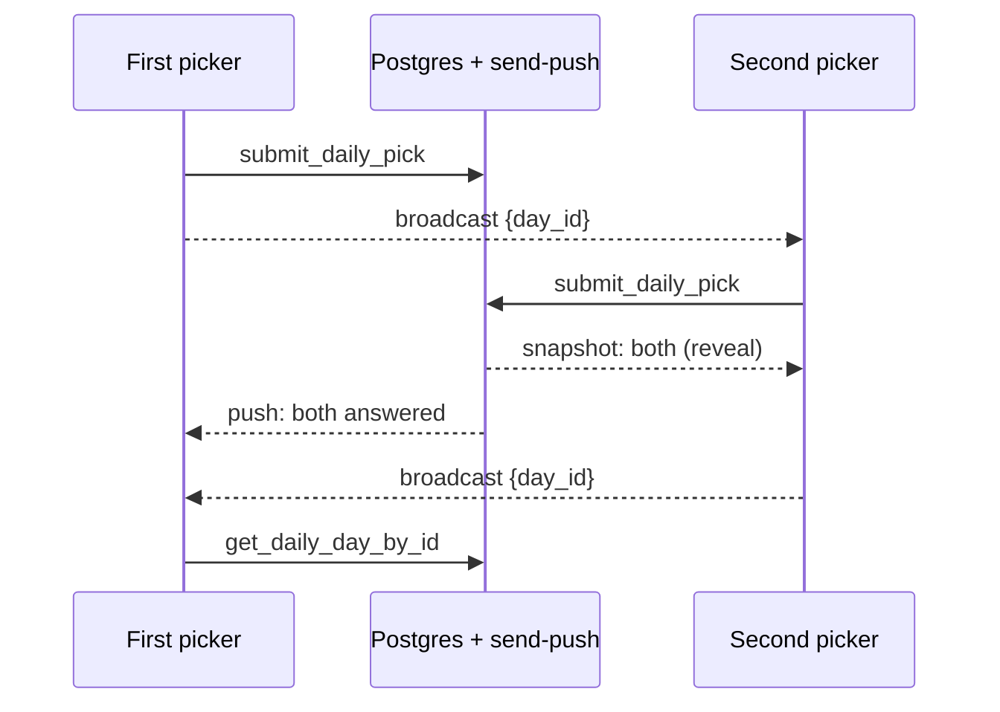

# Architecture Spine: Daily Question

## Design Paradigm

**Immutable facts, server-side projections.** Picks and reminder rows are insert-only facts in Postgres, and a nudge row is inserted once and only its `released_at` is set, once, by the release of a held nudge. The day's question, the reveal and the streak are projections, each computed by exactly one SQL function. Clients hold cached projections (local copies) and an outbox (the pick queue), and never compute a projection themselves. All of it sits inside the app's existing layering:

| Layer | Lives in | Holds |
| --- | --- | --- |
| View | `src/components/DailyQuestion/`, the rebuilt Partner page (new folder, epic 7) | Renders slice state; no Supabase calls |
| State | `src/stores/slices/dailyDaySlice.ts`, `dailyStreakSlice.ts`, `dailyHistorySlice.ts` (epic 8 story 1 splits `dailyQuestionSlice.ts`) | Day: day snapshots, own queued pick, queue drain, write prompt, nudge. Streak: streak snapshot, celebration claims. History: past questions and their paging |
| Client services | `src/api/dailyQuestionApi.ts`, `src/services/pickQueue.ts`, `localCopy` kinds | Client RPC calls, outbox, cached projections |
| Server projections | SQL functions in `supabase/migrations/` | Assignment, pick gate, snapshot, streak, due reminders |
| Facts | Tables in `public` with RLS | Questions, days, picks, nudges, reminders, zones |
| Delivery | `send-push`, `pg_cron`, Broadcast | Pushes and live signals; they read facts and never write them |

None of this touches Home's bundled daily message (`DailyMessage/`, `messagesSlice`), which must not change.

Arrows point the only way a dependency may run. Views never call the API directly. Client RPCs never touch a fact table except through an internal function. `send-push` never writes a fact.

## Invariants & Rules

### AD-1: The couple is the ordered pair [ADOPTED]

- **Binds:** every couple-scoped table in epics 6–9
- **Prevents:** epics keying the couple differently, so history splits and joins fail
- **Rule:** couple-scoped rows carry `user_a uuid, user_b uuid` with `check (user_a < user_b)`, as `couple_settings` does. Linking to a different partner starts a new pair with an empty history, and nothing is copied across. Relinking the same partner resumes the old pair; the unlinked days count as missed.

### AD-2: The server derives every date

- **Binds:** R17, R20; epics 6, 7, 8
- **Prevents:** a client-built `YYYY-MM-DD` disagreeing with the date the server times pushes and closes days on
- **Rule:**
  - A day fetch's date is `now()` in the zone that fetch sends. A pick's date is `picked_at` (the device instant the pick was made) in the zone sent with it.
  - A zone is an IANA name, from `Intl.DateTimeFormat().resolvedOptions().timeZone`, sent together with `utc_offset_minutes`. The offset is east-positive, `-getTimezoneOffset()`.
  - One internal helper, `effective_zone(name, offset)`, turns that pair into the only value ever passed to `AT TIME ZONE`. It returns the name when `pg_timezone_names` has it (exact match). Otherwise it returns the offset, applied as an interval, never as a text offset, because Postgres reads those with the sign inverted. It never rejects, because hosted's tzdata lags local's. Each row resolves its zone once, when it is written, and stores the result beside the row.
  - The client uses its device date only to choose which cached day to show. The phone's clock is trusted (initiative Notes).

### AD-3: Each user's zone is stored on the server

- **Binds:** epics 6, 7, 8
- **Prevents:** pushes and day closure each inventing their own idea of a partner's clock
- **Rule:** `user_time_zones (user_id pk, time_zone, utc_offset_minutes, effective_zone, reported_at)` holds each user's zone. Only `get_daily_day` writes it, and only when its `reported_at` is newer than the stored one; a `reported_at` later than `now() + 5 min` is clamped to `now()`. A pick never writes it. Only the cron job (AD-9), the streak (AD-7), the nudge's hold and closing instant (AD-17) and `user_local_date` (AD-10, which `send-push` no longer calls) read the stored zone; a fetch dates itself with the zone it sends. Closing day `d` uses each partner's zone from their own pick of `d` when that pick exists, and the stored zone otherwise. A user with no row gets no scheduled push, and their days close on UTC.

### AD-4: One function assigns the day's question

- **Binds:** R1, R3, R4; epics 6, 8
- **Prevents:** the client and the 8 PM reminder each drawing a question, a question repeating within a cycle, two written questions both claiming one date, both partners asked to write on one day
- **Rule:** only the internal `assign_couple_day(user_a, user_b, day)` creates a `couple_days` row. It takes `pg_advisory_xact_lock` on the pair, then inserts into `couple_days` (`unique (user_a, user_b, day)`, `cycle int not null`, `writer uuid not null`) on conflict do nothing, then selects. It takes the couple's earliest pending written question whose `target_day <= day`, so a question whose own date got no row is still asked next. Otherwise it draws at random from the coach's questions plus the couple's own, excluding every `question_id` in the current cycle; when none is left, it starts cycle `max + 1`. Each row stores its writer, `couple_days.writer`, fixed from the date alone: `user_a` when `day - date '2000-01-01'` is even, else `user_b`. It is never derived from a count of rows, so a date with no row still keeps the turns alternating. A written question goes in only through `submit_written_question(day_id, this_text, that_text)`, which takes the same pair lock and records `source_day_id`. It refuses unless the caller is `day_id`'s writer, the caller's own pick of `day_id` exists and `day_id`'s `day` is still the caller's current date (AD-2), so the prompt follows the writer's pick, never the reveal, and a turn ends with its date. Its target is the first date after `day_id`'s `day` that has no `couple_days` row, so an ahead partner having already opened the next date does not push it to the pool. `unique (source_day_id)` holds it to one per source day, and a retry returns the existing row unchanged. "No thanks" writes nothing, and an unused turn is not carried over.

### AD-5: One gate releases a pick's choice

- **Binds:** R2, C1; epics 6, 7, 8, 9
- **Prevents:** a function running with owner rights, or `send-push` under the service role, reading `choice` past the RLS policy; and the self-referencing policy failing with 42P17
- **Rule:**
  - `visible_daily_picks(viewer, at)` is a `security definer` set-returning internal function, and the only SQL that selects `daily_picks.choice`. It returns the viewer's own rows. It returns a partner's row only where the viewer's own pick for that `day_id` exists and the day belongs to the viewer's current pair.
  - `daily_picks` grants `authenticated` nothing, SELECT included (AD-15), so no direct read can go around the gate, and no table policy duplicates its rule. `service_role` gets column SELECT on every `daily_picks` column except `choice`.
  - The fact that a partner picked (the snapshot's `state`) is deliberately visible (the waiting screen and a nudge rest on it); "no trace" in the Done-when means the choice. No broadcast or push payload ever carries a `choice`.
  - A local copy holds a partner's `choice` only when it came from a server answer the gate released to that account.
  - `send-push` never reads `choice`.
  - One pgTAP file calls every client RPC as the second partner before their own pick and asserts that no choice, Same/Different mark or count for that day comes back. It also asserts that a direct select on `daily_picks` as that partner is denied. Every new client RPC is added to that file in the same change.

### AD-6: Picks are insert-only, and written through one RPC

- **Binds:** R1, R17; epics 6, 7, 8
- **Prevents:** a pick changed after the reveal, a duplicate from an offline retry, a back-dated pick through the API, and a race that decides which pick was second
- **Rule:**
  - `submit_daily_pick(day_id, choice, picked_at, time_zone, utc_offset_minutes)` is the only write path. `choice` is `'this' | 'that'`.
  - It locks the `couple_days` row (`for update`) and checks that the day is the caller's pair's. It checks that the AD-2 date equals `day`, and fails with its own error code when it does not. It checks `created_at − 5 min ≤ picked_at ≤ now() + 5 min`.
  - It stores `is_second` (whether the partner's pick already exists).
  - It is idempotent on `unique (day_id, user_id)`: a repeat returns the stored pick and never updates it.
  - It returns the AD-16 snapshot. After a confirmed submit, the client broadcasts `daily_pick { day_id }` (AD-11).

### AD-7: One function defines the streak

- **Binds:** R5, R6, R7, R9, R11, R17, R20; epics 7, 8
- **Prevents:** the Partner page, Daily and the push copy counting the streak three different ways
- **Rule:**
  - The internal `couple_streak(user_a, user_b, viewer, at)` returns `held` (the streak), `run` (days in a row), `today_state` (`grey | orange | blue`, for the viewer's date), `milestones` (`floor(held / 25)`), `same`, `done`, `missed` and `week`. `missed` is the number of missed dates after the newest done date, or of all missed dates when none is done. `week` is seven `{ day, state: 'done' | 'missed' | 'open' }`, oldest first, ending on the viewer's date; a date before the couple's first day is `open`. No client works out a day's state itself.
  - The viewer's date is `at` in the viewer's stored zone (AD-3), UTC with no row, for a client; `send-push` reads no streak or date (story 11.2).
  - Day `d` is done when both picks exist. It is closed once `at` passes the later of the two partners' local midnights ending `d` (AD-3).
  - A missed day is any closed calendar date since the couple's first `couple_days.day` that is not done, including dates with no row.
  - `run` is the number of done dates after the newest missed date, or of all done dates when none is missed; an open day never breaks it.
  - `today_state` is orange when today is done, else blue when `missed > 0`, else grey. So blue ends as soon as a done date is newer than every missed one, even before that date has closed on both partners' clocks, and blue never comes with `missed` 0.
  - Nothing is stored, so a late pick corrects the result by itself.
  - Same/Different is decided per day inside AD-16's snapshot, and `couple_streak` sums those same marks.
  - The client RPC `get_couple_streak()` passes `auth.uid()` and answers `{ status: 'ok', streak } | { status: 'unlinked' }`; `send-push` no longer calls it (story 11.2). In copy, "streak" means `held` and "in a row" means `run`.

### AD-8: Time-dependent SQL takes the instant, internally

- **Binds:** epics 6, 7, 8 Done-when tests over faked days
- **Prevents:** untestable functions, and a client faking "now" to assign future days or pick past ones
- **Rule:** every internal function whose result depends on time takes `at timestamptz` and reads no other clock. Client RPCs never take `at`; they pass `now()`. pgTAP calls the internal functions with fixed instants. E2E follows the existing `clockAnchor()` rule.

### AD-9: The server schedules the 8 PM reminder

- **Binds:** R14, C2, C4; epic 8
- **Prevents:** phone-scheduled notifications that the date reminders' cancel-all deletes, and conditions on the partner's pick that the phone cannot see
- **Rule:**
  - A named `pg_cron` job, `*/5 * * * *`, calls `enqueue_daily_reminders(at)`. Epic 8's migration creates the extension on hosted, where it is available but not installed, and re-schedules the job by name, which is idempotent. A second named job deletes `cron.job_run_details` rows older than 7 days. Any removal guards `cron.unschedule` with an existence check.
  - Before it looks at any user, the function calls `release_held_daily_nudges(at)` in its own exception block (AD-17): a nudge held until its recipient's 08:00 goes out on the first tick of 08:00–08:30 on their clock. The function considers only users with a linked partner and at least one `push_devices` row. It handles each user in its own exception block, as `notify_push` does. It inserts `(user_id, kind, local_date, day_id)` into `daily_reminders (user_id, kind, slot, local_date, day_id, unique (user_id, local_date, slot))`, where `kind` is `evening_self` alone, and `day_id` is `not null` and cascades with `couple_days`, so `reset_bot_daily_days` still clears a pair. `slot` is a stored generated column from `kind` that now always reads `evening` (kept, because the unique key names it). No insert sets it.
  - It calls `assign_couple_day` (AD-4) for the recipient's local date before inserting, so every row has a day and the who-has-picked test reads that day's picks. At 08:00 the loop never reaches `assign_couple_day`, so the 08:00 tick assigns no day: the held-nudge release is the only work it does there (story 11.2).
  - The one reminder is due 20:00–20:30 local while the recipient has not picked, whether or not their partner has, and goes only to that person: `evening_self` ("Time's running out!", opens Daily). A person who has picked gets no 8 PM push, and there is no 8 AM push. Story 11.2 removed the stored `morning` and `evening_partner` kinds: the migration deletes their rows and `daily_reminders_kind_check` allows `evening_self` alone.
  - A missed window sends nothing. A failed post is not retried (accepted; the signal is `net._http_response` and `cron.job_run_details`).
  - The phone never schedules a daily push, so `reminderIdsToCancel` stays as it is.

### AD-10: Every push starts from a row insert, or a held nudge's release [ADOPTED]

- **Binds:** R13, R14, R19, C2; epics 8, 10
- **Prevents:** a second push path that skips the dedupe and the switch check, two kinds sharing one dedupe column with no map, the order of picks being guessed when the push is sent, and epic 10 breaking installed shells
- **Rule:**
  - One trigger per kind calls `notify_push('<final kind>')`, and `send-push` resolves the row with its privileged key (the new secret key, PR #469). Each has a `WHEN` clause except the `daily_reminders` one, which has none because every row is the one reminder. Every trigger is AFTER INSERT but the second `daily_nudges` one, which is AFTER UPDATE OF `released_at` and posts a held nudge when the hold ends (AD-17):

    | Trigger table | `WHEN` | Posted kind | `push_requests` column | Recipient |
    | --- | --- | --- | --- | --- |
    | `daily_picks` | `new.is_second` | `daily_both_answered` | `daily_pick_id` | The first picker |
    | `daily_nudges` (insert) | `not new.held` | `daily_nudge` | `daily_nudge_id` | `to_user` |
    | `daily_nudges` (update of `released_at`) | `old.released_at is null and new.released_at is not null` | `daily_nudge` | `daily_nudge_id` | `to_user` |
    | `daily_reminders` | none (every row is `evening_self`) | `daily_reminder` | `daily_reminder_id` | `user_id` |

  - The FKs are `on delete cascade`, each `unique` with `token`. The source check names the full column list.
  - `send-push` never infers order or variant: it reads the posted kind and, for a reminder, the stored `kind`, which must be `evening_self`; a stored kind that is not (a `morning` or `evening_partner` row left over) is no push, and a pick that is not second is no `daily_both_answered`. It sends `daily_both_answered` on every second pick, an offline pick that lands after its day included; a pick is refused unless its own local date is the day (AD-6), so no closed-day test could ever drop one. Its wording is the same whatever the day or the streak (owner, 2026-11-27; `push-copy.md`): "You both answered today's question" over "Click to see what your partner answered!". `send-push` reads no recipient date and no streak, so `user_local_date` and `couple_streak` have no caller in it (story 11.2). A post of `daily_question` or `daily_partner_picked`, the two kinds epic 8 added and story 11.2 removed, is a 400 that claims nothing.
  - `daily_nudge` and `daily_reminder` set `aps.sound` to `default`, the sound date reminders play (`REMINDER_SOUND`). `daily_both_answered` carries no `sound`, like every existing push.
  - Each kind has one `push_preferences` column, `boolean not null default true`, named after the kind and mapped in `PREFERENCE_FOR_KIND`. The `daily_question` and `daily_partner_picked` columns stay with their values and defaults, because installed builds read them by name until they take the live update; neither the app nor `send-push` reads or writes them from story 11.2 on, and epic 10 drops them (DW-548).
  - Epic 8 ships the sender's new kinds one deploy before the triggers, because the old `POSTED_KINDS` rejects unknown kinds.
  - Epic 10 removes the mood and interaction columns from `push_requests`, the source check and `push_preferences` in two steps: stop reading them and ship, then drop them in a later migration, as `20261104000000_drop_push_preferences_dates.sql` did. Epics 8 and 9 never select a column epic 10 drops.

### AD-11: Live signals use the existing topic and one event registry [ADOPTED]

- **Binds:** C3; epics 6, 7, 8, 10
- **Prevents:** a direct `supabase.channel()`, a new topic prefix the realtime policies reject, an event registry that only knows moods, and epic 10 removing `partner_linked`
- **Rule:** epic 6 turns `moodSyncService`'s registry into `subscribePartnerEvents(handlers)` over one `PartnerEvent` union: `partner_linked`, `daily_pick`, `daily_nudge`, `dates_changed`, plus `new_mood` until epic 10. Each event is validated in `broadcastSchemas.ts` and bound when the channel is created. Each goes out through `sendEphemeralBroadcast` to the partner's `mood-updates:<uid>` topic. The daily events carry payload `{ day_id }`; a receiver re-reads that `day_id` (AD-16) and treats the event as nothing more. `dates_changed` carries none, and its receiver re-reads both date lists. No daily table joins the `supabase_realtime` publication. Epic 10 removes `new_mood` from the union and keeps the topic, the registry, `partner_linked` and `dates_changed`.

### AD-12: An offline pick waits in its own queue

- **Binds:** R17; epic 6
- **Prevents:** a queued pick overwritten by a refresh, shown as revealed, picked twice, or silently dropped
- **Rule:**
  - An unsent pick is a row in a new `pick-queue` IndexedDB store, added through `dbSchema.ts` under the IndexedDB rules in AGENTS.md. Each row holds `user_id`, `day_id`, `choice`, `picked_at`, `time_zone`, `utc_offset_minutes` and `failed`, keyed `[user_id, day_id]`, with a `by-user` index, as `note-queue` is.
  - `dailyDaySlice` drains only the signed-in account's rows, oldest first, under `withSyncLock`, on `online` and at start.
  - The own pick shown is the server's pick, else the queued row. The pick control is disabled while either exists. A queued pick never goes into a local copy, and the reveal shows only from a server snapshot.
  - The client refuses a pick when the device date is not the shown day's `day`, and re-fetches. A device with no day for today shows that it needs a connection.
  - A server rejection marks the row failed, and the failure is shown. The queue survives sign-out.

### AD-13: Cached projections are local-copy kinds that only a success overwrites

- **Binds:** R8, R9, R18, R13; epics 6, 7, 8
- **Prevents:** an unlinked answer and a failed read both blanking Daily, a feature-private cache, and celebration state clobbered by a refresh
- **Rule:**
  - Day snapshots are one `localCopy` kind, a map keyed by `day_id`; today is one entry of it, never a second copy, and the past-question pages merge into it with no cap. Every write of a snapshot to the map goes through one merge rule under a lock. An entry's `state` never moves back (`none` → `me` or `partner` → `both`), nor its `write.done`, nor either source's nudge sent (`nudges.prompt_sent`, `nudges.button_sent`: each is the OR of the stored and the new entry, and a nudge sent in memory after an "already sent" refusal counts the same), so a slow read cannot undo a reveal, reopen the write prompt, bring back the nudge prompt or re-enable a Nudge button that was used. An entry saved by the build before the per-question nudges carries `nudge { slot, spent }` and no `nudges`; it is read by one reader (`nudgeState`), which maps the old slot names only to read such a day, never as a limit: the old build's first slot sent is the prompt's nudge sent, its second the button's, and it has no closing instant, so its unsent button stays hidden until the server answers for that day. A server answer for a date drops every other `day_id` saved for that date, whichever partner it was read with, because a relink or `reset_bot_daily_days` gives the date a new day. The streak snapshot is a second kind.
  - Both kinds are tagged with the partner they were read with: `partner_id`, on each entry of the map and once on the streak, and `null` when no partner is known. Reading a copy gives only what carries the current partner's tag, so a day or streak tagged with an old partner stays hidden. The one exception is Daily's saved day for the device's date, which also shows an entry tagged `null` or not tagged, so a day saved before tags existed still shows offline. Past questions and the streak hide such data once a partner is known.
  - `get_daily_day(time_zone, utc_offset_minutes, reported_at)` answers `{ status: 'ok', snapshot } | { status: 'unlinked' }` and throws on failure. Only a successful answer writes a copy. `unlinked` shows the invitation to link (R18) and empties the map; `get_couple_streak`'s `unlinked` deletes the streak copy.
  - Celebration state is its own kind, `daily-celebrated { held, milestones }`, written only by the animation. A first read with none stored seeds it from the current snapshot without playing. The +1 animation (R8) and the milestone screen (R9) play only when the snapshot exceeds it, never because a realtime event arrived.
  - A second device-state kind, `daily-write-declined`, holds the `day_id`s whose write prompt (AD-4) this account declined on this device, written only by "No thanks". The prompt shows while `write.mine` is true, `write.done` is false and the `day_id` is not in it, so another device may ask once more. These are the only two device-state kinds; the `localCopy.ts` header exempts both from the server-fill rule in the same change, and sign-out deletes them with the account's other kinds.

### AD-14: A reply references its day

- **Binds:** R10; epic 9
- **Prevents:** a reply copying question text that drifts from the day, and a reply naming another couple's day
- **Rule:** `love_notes.couple_day_id uuid null references couple_days(id) on delete set null`. The pair check is added with `alter policy "Users can insert their own messages"`, never as a second permissive policy, which would be OR-ed away. The check calls a definer helper, `couple_day_in_pair(couple_day_id, from_user_id, to_user_id)`, listed in FN-GRANT-008, and never selects `couple_days` directly. The same migration recreates `love_notes_visible`, whose `select n.*` fixed its columns. A queued note carries the day id, and a refused one is marked failed, as `note-queue` already does. The attachment is read through `get_daily_day_by_id`. The `love-notes` copy stores the joined text for offline use, and `send-push` joins the day only within the note's pair.

### AD-15: Two tiers of functions, no direct writes

- **Binds:** all new SQL in epics 6–9
- **Prevents:** a client RPC that takes any pair's ids, an internal function reachable on hosted through its default EXECUTE grant, and a direct PostgREST insert that skips the checks
- **Rule:**
  - Internal functions (`effective_zone`, `assign_couple_day`, `visible_daily_picks`, `daily_day_snapshot`, `couple_streak`, `enqueue_daily_reminders`, `release_held_daily_nudges`, `record_daily_nudge`, `user_local_date`) take the pair, viewer and `at`. Each is `revoke execute … from public, anon, authenticated`; `service_role` keeps EXECUTE, which `send-push` uses.
  - Client RPCs (`get_daily_day`, `get_daily_day_by_id`, `get_daily_history`, `submit_daily_pick`, `submit_written_question`, `send_daily_nudge`, `get_couple_streak`, `reset_bot_daily_days`) are `security definer` with `set search_path = ''`. They take no pair, viewer or `at`, and derive the pair from `auth.uid()` and `get_my_partner_id()`. They and `couple_day_in_pair` (AD-14) are the only new entries in FN-GRANT-008.
  - `reset_bot_daily_days()` exists only for the live-site check (epic 6). It deletes the calling user's couple's `couple_days` rows, their picks cascading, and refuses unless the caller's email is `test_email` or `partner_email` in `claude_bot_config`. It is the one path that deletes a pick, and no client code calls it; the check never uses the Supabase secret key.
  - No daily table (`daily_questions`, `couple_days`, `daily_picks`, `daily_nudges`, `daily_reminders`, `user_time_zones`) grants `anon` or `authenticated` any privilege, SELECT included. Every read and write goes through a client RPC. So question text reaches a client only inside a snapshot, and a pending written question stays hidden until its day is assigned.
  - Every table enables RLS in its creating migration, with no policies.

### AD-16: One day snapshot

- **Binds:** R2, R10, R11; epics 6, 7, 8, 9
- **Prevents:** today, history, the reply attachment and the live re-read each inventing a row shape and reading around the gate
- **Rule:** the internal `daily_day_snapshot(day_id, viewer, at)` returns `{ day_id, day, question { this, that }, state: 'none' | 'me' | 'partner' | 'both', my_choice, my_picked_at, partner_choice | null, same | null, nudges { prompt_sent, button_sent, closes_at }, write { mine, done } }`, reading choices only through AD-5. `my_picked_at` is the viewer's own pick instant, null until that pick exists; the snapshot carries no question number. `nudges` gives, for each source of a nudge (AD-17), whether the viewer's nudge about this day is on record, and `closes_at`, the end of the day on the partner's clock (their stored zone, UTC with no row, AD-3) as a UTC timestamp while the viewer has picked, the partner has not and the link goes both ways, otherwise null. The server does not null it after the instant; the client compares it with its own clock. The snapshot has no `nudge` key: an installed build from before the per-question nudges makes its whole `nudge` object optional, so leaving it out is safe and leaves that build with no prompt and a greyed button until it takes the live update, while removing or renaming its `slot` or `spent`, or giving `slot` a new value, would fail its parse. `write.mine` is whether the viewer is the day's writer (AD-4), `write.done` whether a question from this day exists. `get_daily_day` (the caller's date), `get_daily_day_by_id`, `submit_daily_pick` and `get_daily_history` (an array, newest first) all return it.

### AD-17: A question takes one nudge per sender from each of two sources

- **Binds:** R13; epics 8, 11
- **Prevents:** nudge spam, a client-only limit that a retry gets around, a limit tied to a date or a clock, and a nudge lost because the partner's day has not started
- **Rule:**
  - `send_daily_nudge(day_id, source default 'button')` inserts into `daily_nudges (from_user, to_user, day_id, source, held, released_at, created_at, unique (from_user, day_id, source))`, with `source in ('prompt', 'button')`; `day_id` is `not null` and cascades with `couple_days`. The limit is one nudge per sender per question from each source, keyed on the question, never on a date or a clock: the other source is still taken, a nudge about yesterday's question leaves today's open, and the sender's own midnight resets nothing. The one-argument call an installed build makes is the button's nudge. A second nudge from the same source is refused (`DQ010`) and records nothing; a concurrent duplicate loses the unique key and is refused the same way.
  - A nudge needs the sender's own pick for the day to exist, the partner's not to, and the partner link to go both ways (the sender's `partner_id` names the partner and the partner's names the sender, as `enqueue_daily_reminders` reads it; otherwise `P0002`). The partner's clock is their stored zone, UTC with no row (AD-3), and the server reads no other zone. The day stops taking nudges at its end on the partner's clock: a nudge at or after that instant is refused (`DQ009`) and records nothing.
  - A nudge sent before 08:00 on the partner's clock on that day, whether the day has not started there or it is between 00:00 and 08:00, is recorded at once with `held` true and posts no push; the sender sees the normal result. `release_held_daily_nudges(at)`, which `enqueue_daily_reminders` calls (AD-9), sets `released_at` on a held nudge when the partner's clock reads 08:00–08:30 on that day, the partner has a stored zone and has not picked, and the link still goes both ways, and the AFTER UPDATE trigger posts it (AD-10). A held nudge never sets `released_at` when the partner has answered, has no stored zone, or the window was missed, and it still counts as that source's nudge. When both of a sender's nudges about one question are held, the earlier is released and the other is not; when the other was already pushed after the partner's 08:00, the held one is dropped. So at most one push goes out per question and sender in that tick, and a nudge sent after the partner's 08:00 posts on insert as before.
  - Only a tap inserts a nudge: on the prompt after an answer ("Do you want to nudge your partner?", shown once after the answer, after the write sheet however it closes, or when a pick saved offline is sent while Daily is open) or on the waiting screen's Nudge button. Not now ends only the prompt. A control that was never sent and can no longer be is hidden, not greyed: after `nudges.closes_at`, which the client flips at that instant with no re-read, or while a day saved by an older build waits for the server's answer. Grey means sent.
  - A send whose answer is lost is not shown as failed: the client re-reads the day, and the control stays disabled until the re-read ends; a re-read that has the nudge ends it as sent, one that has none shows "Your nudge could not be sent.", and one that fails shows "We couldn't check if your nudge went through. Try again?". An `already sent` refusal ends as a sent nudge.
  - No other push carries a nudge. The push has the same title and body for every nudge, and follows the partner's Nudges switch and devices when it is sent.

## Consistency Conventions

| Concern | Convention |
| --- | --- |
| Table names | `daily_questions`, `couple_days`, `daily_picks`, `daily_nudges`, `daily_reminders`, `user_time_zones` |
| Push kinds | `daily_nudge`, `daily_reminder`, `daily_both_answered` |
| Broadcast events | `daily_pick`, `daily_nudge`; payload `{ day_id }` only |
| Client names | `DailyQuestion` / `dailyQuestion*`, never `DailyMessage` or `messagesSlice` (Home's bundled message) |
| View | `ViewType` `'daily'` at `/daily`, in the dock's second slot (R12), with all five registration places from AGENTS.md. Epic 6 redirects `/mood` to `/daily`; epic 8 story 4 routes the daily push kinds to Daily in `viewForPush` (`VIEW_FOR_KIND`), which keeps `daily_question` and `daily_partner_picked` for a push of either delivered before story 11.2 and tapped after; epic 10 deletes the mood view |
| Partner page | Epic 7 builds it in a new folder; epic 10 deletes `PartnerMoodView/` |
| Ids | uuid `gen_random_uuid()`; coach questions are seeded by migration with fixed uuids, so an edit is idempotent |
| Choice | `text check (choice in ('this','that'))` |
| Store actions | Capture `{ userId, authSessionVersion }` before every await; new slice fields go in `signedOutState()` |
| Tests | Each new policy goes in its `policies_are` file; each new `registerLocalCopy` read is stubbed in `auth-bootstrap-notification-order.tsx` and `login.spec.ts` |

## Stack

| Name | Local / CI | Hosted |
| --- | --- | --- |
| Postgres (`supabase/postgres`) | 17.11.0.006 | 17.6.1.048 |
| pg_cron | 1.6.4, not installed | 1.6.4, not installed (epic 8 installs it) |
| pg_net | 0.20.4 | 0.19.5 |
| Supabase CLI | 2.122.0 | n/a |
| React | ^19.3.1 | same build |
| @supabase/supabase-js | ^2.118.0 | same build |
| Zustand | ^5.0.16 | same build |
| @capacitor/push-notifications | ^8.1.3 | same build |
| idb | ^8.0.4 | same build |

## Structural Seed

`daily_questions` holds the coach's rows (pair null) and the couple-written ones (pair set, `target_day` while pending).

Deployment does not change. `deploy.yml` applies the migrations (tables, functions, the extension and the two cron jobs), then deploys `send-push`, then the site. Live updates carry the web code to the shells, and none of this needs native code. On local and CI stacks, the cron job finds no user with a push device unless a test adds one, and with no `push_sender_settings` row nothing is posted.

## Capability → Architecture Map

| Capability | Lives in | Governed by |
| --- | --- | --- |
| R1 same question, own pick | `couple_days`, `submit_daily_pick` | AD-1, AD-4, AD-6 |
| R2 / C1 hidden pick | the gate, the policy, the pgTAP file | AD-5, AD-15, AD-16 |
| R3, R4 written questions in turns, pool | `submit_written_question`, `assign_couple_day` | AD-4 |
| R5–R7, R9, R11 streak, run, colours, milestones, Same/Different | `couple_streak`, snapshot | AD-7, AD-8, AD-16 |
| R8 +1 animation | `daily-celebrated` copy | AD-13 |
| R10 reply attached | `love_notes.couple_day_id` | AD-14, AD-16 |
| R12 Daily tab | navigation registration | Conventions (View) |
| R13 nudge | `daily_nudges`, `send_daily_nudge` | AD-17, AD-10, AD-11 |
| R14 three pushes | `daily_reminders`, `pg_cron`, triggers | AD-3, AD-9, AD-10 |
| R15, R16 removal | epic 10 | AD-10 (two-step drop), AD-11 (topic kept) |
| R17 offline pick | `pick-queue`, `submit_daily_pick` | AD-2, AD-6, AD-7, AD-12 |
| R18 unlinked | `get_daily_day` status | AD-13 |
| R19 switches | `push_preferences` columns | AD-10 |
| R20 own clocks | `user_time_zones`, date derivation | AD-2, AD-3, AD-7 |
| C4 date reminders | unchanged | AD-9 |

## Deferred

- **Push copy and badge rules** (epic 8): settled in the epic's `push-copy.md` (AD-7's naming, the mock-up's notifications screen, the owner's 2026-11-25 wording) and built in `send-push/payload.ts`.
- **Renaming `mood-updates:` and `moodSyncService`** (after epic 10): needs a policy change and both partners' clients updated together.
- **Pool authoring and the size check** (epic 6): content work, with "about 500" checked by a count.
- **Moving `formatDateKey` out of `calendarHelpers.ts`** (epic 6, before epic 10 deletes the mood calendar).
- **Cron observability beyond `cron.job_run_details`** (epic 8): no dashboard is planned.
