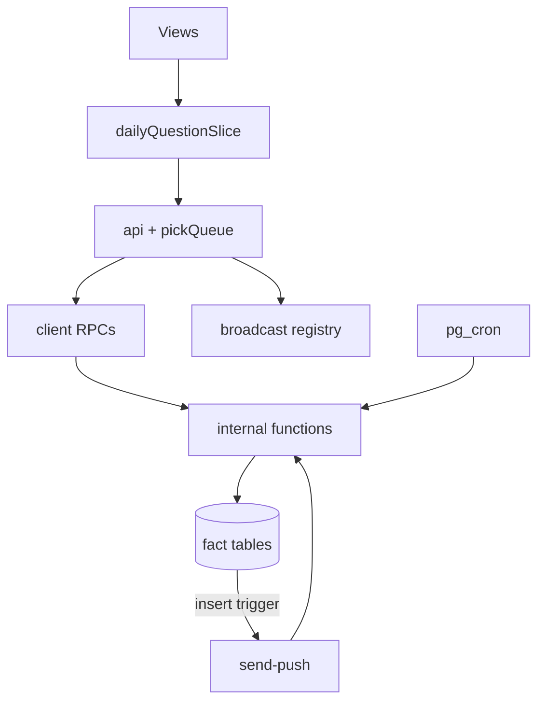
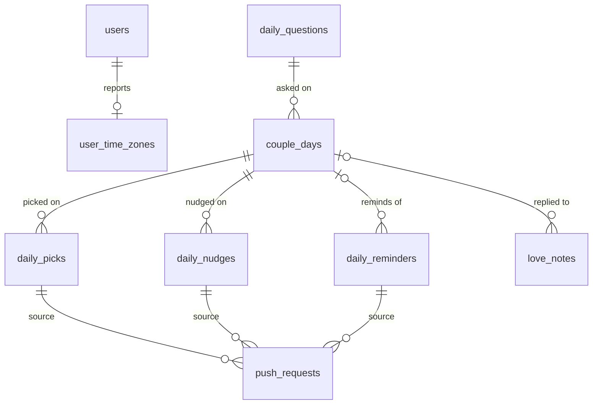
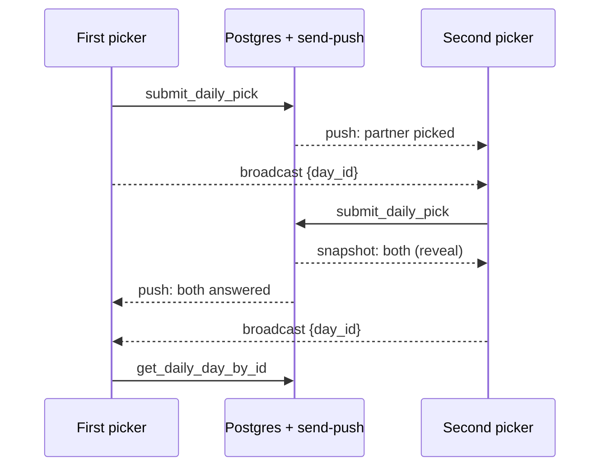

# Architecture Spine: Daily Question

## Design Paradigm

**Immutable facts, server-side projections.** Picks, nudges and reminder rows are insert-only facts in Postgres. The day's question, the reveal and the streak are projections, each computed by exactly one SQL function. Clients hold cached projections (local copies) and an outbox (the pick queue), and never compute a projection themselves. All of it sits inside the app's existing layering:

| Layer | Lives in | Holds |
| --- | --- | --- |
| View | `src/components/DailyQuestion/`, the rebuilt Partner page (new folder, epic 7) | Renders slice state; no Supabase calls |
| State | `src/stores/slices/dailyQuestionSlice.ts` | Day snapshots, own queued pick, streak snapshot, queue drain |
| Client services | `src/api/dailyQuestionApi.ts`, `src/services/pickQueue.ts`, `localCopy` kinds | Client RPC calls, outbox, cached projections |
| Server projections | SQL functions in `supabase/migrations/` | Assignment, pick gate, snapshot, streak, due reminders |
| Facts | Tables in `public` with RLS | Questions, days, picks, nudges, reminders, zones |
| Delivery | `send-push`, `pg_cron`, Broadcast | Pushes and live signals; they read facts and never write them |

None of this touches Home's bundled daily message (`DailyMessage/`, `messagesSlice`), which must not change.

Arrows point the only way a dependency may run. Views never call the API directly. Client RPCs never touch a fact table except through an internal function. `send-push` never writes a fact.

## Invariants & Rules

### AD-1: The couple is the ordered pair [ADOPTED]

- **Binds:** every couple-scoped table in epics 6–9
- **Prevents:** epics keying the couple differently, so history splits and joins fail
- **Rule:** couple-scoped rows carry `user_a uuid, user_b uuid` with `check (user_a < user_b)`, as `couple_settings` does. Linking to a different partner starts a new pair with an empty history, and nothing is copied across. Relinking the same partner resumes the old pair; the unlinked days count as missed.

### AD-2: The server derives every date

- **Binds:** R17, R20; epics 6, 7, 8
- **Prevents:** a client-built `YYYY-MM-DD` disagreeing with the date the server times pushes and closes days on
- **Rule:**
  - A day fetch's date is `now()` in the zone that fetch sends. A pick's date is `picked_at` (the device instant the pick was made) in the zone sent with it.
  - A zone is an IANA name, from `Intl.DateTimeFormat().resolvedOptions().timeZone`, sent together with `utc_offset_minutes`. The offset is east-positive, `-getTimezoneOffset()`.
  - One internal helper, `effective_zone(name, offset)`, turns that pair into the only value ever passed to `AT TIME ZONE`. It returns the name when `pg_timezone_names` has it (exact match). Otherwise it returns the offset, applied as an interval, never as a text offset, because Postgres reads those with the sign inverted. It never rejects, because hosted's tzdata lags local's. Each row resolves its zone once, when it is written, and stores the result beside the row.
  - The client uses its device date only to choose which cached day to show. The phone's clock is trusted (initiative Notes).

### AD-3: Each user's zone is stored on the server

- **Binds:** epics 6, 7, 8
- **Prevents:** pushes and day closure each inventing their own idea of a partner's clock
- **Rule:** `user_time_zones (user_id pk, time_zone, utc_offset_minutes, effective_zone, reported_at)` holds each user's zone. Only `get_daily_day` writes it, and only when its `reported_at` is newer than the stored one; a `reported_at` later than `now() + 5 min` is clamped to `now()`. A pick never writes it. Only the cron job (AD-9), closure (AD-7) and the nudge slot (AD-17) read the stored zone; a fetch dates itself with the zone it sends. Closing day `d` uses each partner's zone from their own pick of `d` when that pick exists, and the stored zone otherwise. A user with no row gets no scheduled push, and their days close on UTC.

### AD-4: One function assigns the day's question

- **Binds:** R1, R3, R4; epics 6, 8
- **Prevents:** the client and the 8 AM push each drawing a question, a question repeating within a cycle, two written questions both claiming one date, both partners asked to write on one day
- **Rule:** only the internal `assign_couple_day(user_a, user_b, day)` creates a `couple_days` row. It takes `pg_advisory_xact_lock` on the pair, then inserts into `couple_days` (`unique (user_a, user_b, day)`, `cycle int not null`, `writer uuid not null`) on conflict do nothing, then selects. It takes the couple's earliest pending written question whose `target_day <= day`, so a question whose own date got no row is still asked next. Otherwise it draws at random from the coach's questions plus the couple's own, excluding every `question_id` in the current cycle; when none is left, it starts cycle `max + 1`. Each row stores its writer, `couple_days.writer`, fixed from the date alone: `user_a` when `day - date '2000-01-01'` is even, else `user_b`. It is never derived from a count of rows, so a date with no row still keeps the turns alternating. A written question goes in only through `submit_written_question(day_id, this_text, that_text)`, which takes the same pair lock and records `source_day_id`. It refuses unless the caller is `day_id`'s writer, the caller's own pick of `day_id` exists and `day_id`'s `day` is still the caller's current date (AD-2), so the prompt follows the writer's pick, never the reveal, and a turn ends with its date. Its target is the first date after `day_id`'s `day` that has no `couple_days` row, so an ahead partner having already opened the next date does not push it to the pool. `unique (source_day_id)` holds it to one per source day, and a retry returns the existing row unchanged. "No thanks" writes nothing, and an unused turn is not carried over.

### AD-5: One gate releases a pick's choice

- **Binds:** R2, C1; epics 6, 7, 8, 9
- **Prevents:** a function running with owner rights, or `send-push` under the service role, reading `choice` past the RLS policy; and the self-referencing policy failing with 42P17
- **Rule:**
  - `visible_daily_picks(viewer, at)` is a `security definer` set-returning internal function, and the only SQL that selects `daily_picks.choice`. It returns the viewer's own rows. It returns a partner's row only where the viewer's own pick for that `day_id` exists and the day belongs to the viewer's current pair.
  - `daily_picks` grants `authenticated` nothing, SELECT included (AD-15), so no direct read can go around the gate, and no table policy duplicates its rule. `service_role` gets column SELECT on every `daily_picks` column except `choice`.
  - The fact that a partner picked (the snapshot's `state`) is deliberately visible, as the mock-up's "Jessie made their pick" push shows; "no trace" in the Done-when means the choice. No broadcast or push payload ever carries a `choice`.
  - A local copy holds a partner's `choice` only when it came from a server answer the gate released to that account.
  - `send-push` never reads `choice`.
  - One pgTAP file calls every client RPC as the second partner before their own pick and asserts that no choice, Same/Different mark or count for that day comes back. It also asserts that a direct select on `daily_picks` as that partner is denied. Every new client RPC is added to that file in the same change.

### AD-6: Picks are insert-only, and written through one RPC

- **Binds:** R1, R17; epics 6, 7, 8
- **Prevents:** a pick changed after the reveal, a duplicate from an offline retry, a back-dated pick through the API, and a race that decides which pick was second
- **Rule:**
  - `submit_daily_pick(day_id, choice, picked_at, time_zone, utc_offset_minutes)` is the only write path. `choice` is `'this' | 'that'`.
  - It locks the `couple_days` row (`for update`) and checks that the day is the caller's pair's. It checks that the AD-2 date equals `day`, and fails with its own error code when it does not. It checks `created_at − 5 min ≤ picked_at ≤ now() + 5 min`.
  - It stores `is_second` (whether the partner's pick already exists).
  - It is idempotent on `unique (day_id, user_id)`: a repeat returns the stored pick and never updates it.
  - It returns the AD-16 snapshot. After a confirmed submit, the client broadcasts `daily_pick { day_id }` (AD-11).

### AD-7: One function defines the streak

- **Binds:** R5, R6, R7, R9, R11, R17, R20; epics 7, 8
- **Prevents:** the Partner page, Daily and the push copy counting the streak three different ways
- **Rule:**
  - The internal `couple_streak(user_a, user_b, viewer, at)` returns `held` (the streak), `run` (days in a row), `today_state` (`grey | orange | blue`, for the viewer's date), `milestones` (`floor(held / 25)`), `same` and `done`.
  - Day `d` is done when both picks exist. It is closed once `at` passes the later of the two partners' local midnights ending `d` (AD-3).
  - A missed day is any closed calendar date since the couple's first `couple_days.day` that is not done, including dates with no row.
  - `run` counts back from the newest day that is done or closed; an open day never breaks it.
  - `today_state` is orange when today is done, blue when the newest closed day was missed, and grey otherwise.
  - Nothing is stored, so a late pick corrects the result by itself.
  - Same/Different is decided per day inside AD-16's snapshot, and `couple_streak` sums those same marks.
  - The client RPC `get_couple_streak()` passes `auth.uid()`; `send-push` passes the recipient. In copy, "streak" means `held` and "in a row" means `run`.

### AD-8: Time-dependent SQL takes the instant, internally

- **Binds:** epics 6, 7, 8 Done-when tests over faked days
- **Prevents:** untestable functions, and a client faking "now" to assign future days or pick past ones
- **Rule:** every internal function whose result depends on time takes `at timestamptz` and reads no other clock. Client RPCs never take `at`; they pass `now()`. pgTAP calls the internal functions with fixed instants. E2E follows the existing `clockAnchor()` rule.

### AD-9: The server schedules the 8 AM and 8 PM pushes

- **Binds:** R14, C2, C4; epic 8
- **Prevents:** phone-scheduled notifications that the date reminders' cancel-all deletes, and conditions on the partner's pick that the phone cannot see
- **Rule:**
  - A named `pg_cron` job, `*/5 * * * *`, calls `enqueue_daily_reminders(at)`. Epic 8's migration creates the extension on hosted, where it is available but not installed, and re-schedules the job by name, which is idempotent. A second named job deletes `cron.job_run_details` rows older than 7 days. Any removal guards `cron.unschedule` with an existence check.
  - The function considers only users with a linked partner and at least one `push_devices` row. It handles each user in its own exception block, as `notify_push` does. It inserts into `daily_reminders (user_id, kind, local_date, day_id, unique (user_id, local_date, slot))`, where `kind` is `morning | evening_self | evening_partner` and `slot` is `morning` or `evening`.
  - `morning` is due 08:00–08:30 local while the recipient has not picked. It calls AD-4, so the push can quote the question.
  - The evening reminder is due 20:00–20:30 local unless both have picked, and the variant is decided per recipient when the row is inserted. `evening_self` ("you haven't done your daily yet", opens Daily) goes when the recipient has not picked. `evening_partner` ("your partner hasn't done their daily", opens Daily's waiting screen to nudge) goes when only the recipient has, and is skipped when the recipient's `evening` nudge slot is already spent (AD-17).
  - A missed window sends nothing. A failed post is not retried (accepted; the signal is `net._http_response` and `cron.job_run_details`).
  - The phone never schedules a daily push, so `reminderIdsToCancel` stays as it is.

### AD-10: Every push starts from a row insert [ADOPTED]

- **Binds:** R13, R14, R19, C2; epics 8, 10
- **Prevents:** a second push path that skips the dedupe and the switch check, two kinds sharing one dedupe column with no map, the order of picks being guessed when the push is sent, and epic 10 breaking installed shells
- **Rule:**
  - One AFTER INSERT trigger per kind, each with a `WHEN` clause, calls `notify_push('<final kind>')`, and `send-push` resolves the row with its privileged key (the new secret key, PR #469):

    | Trigger table | `WHEN` | Posted kind | `push_requests` column | Recipient |
    | --- | --- | --- | --- | --- |
    | `daily_picks` | `not new.is_second` | `daily_partner_picked` | `daily_pick_id` | The partner |
    | `daily_picks` | `new.is_second` | `daily_both_answered` | `daily_pick_id` | The first picker |
    | `daily_nudges` | (none) | `daily_nudge` | `daily_nudge_id` | `to_user` |
    | `daily_reminders` | `new.kind = 'morning'` | `daily_question` | `daily_reminder_id` | `user_id` |
    | `daily_reminders` | `new.kind <> 'morning'` | `daily_reminder` | `daily_reminder_id` | `user_id` |

  - The FKs are `on delete cascade`, each `unique` with `token`. The source check names the full column list.
  - `send-push` never infers order or variant: it reads the posted kind and, for a reminder, the stored `kind`. It drops a `daily_partner_picked` push whose `day` is not the recipient's current date. It sends `daily_both_answered` whenever the day was not closed (AD-7) at the second pick's `picked_at`.
  - Each kind has one `push_preferences` column, `boolean not null default true`, named after the kind and mapped in `PREFERENCE_FOR_KIND`. One switch covers both evening variants.
  - Epic 8 ships the sender's new kinds one deploy before the triggers, because the old `POSTED_KINDS` rejects unknown kinds.
  - Epic 10 removes the mood and interaction columns from `push_requests`, the source check and `push_preferences` in two steps: stop reading them and ship, then drop them in a later migration, as `20261104000000_drop_push_preferences_dates.sql` did. Epics 8 and 9 never select a column epic 10 drops.

### AD-11: Live signals use the existing topic and one event registry [ADOPTED]

- **Binds:** C3; epics 6, 7, 8, 10
- **Prevents:** a direct `supabase.channel()`, a new topic prefix the realtime policies reject, an event registry that only knows moods, and epic 10 removing `partner_linked`
- **Rule:** epic 6 turns `moodSyncService`'s registry into `subscribePartnerEvents(handlers)` over one `PartnerEvent` union: `partner_linked`, `daily_pick`, `daily_nudge`, plus `new_mood` until epic 10. Each event is validated in `broadcastSchemas.ts` and bound when the channel is created. Events go out through `sendEphemeralBroadcast` to the partner's `mood-updates:<uid>` topic with payload `{ day_id }`. A receiver re-reads that `day_id` (AD-16) and treats the event as nothing more. No daily table joins the `supabase_realtime` publication. Epic 10 removes `new_mood` from the union and keeps the topic, the registry and `partner_linked`.

### AD-12: An offline pick waits in its own queue

- **Binds:** R17; epic 6
- **Prevents:** a queued pick overwritten by a refresh, shown as revealed, picked twice, or silently dropped
- **Rule:**
  - An unsent pick is a row in a new `pick-queue` IndexedDB store, added through `dbSchema.ts` under the IndexedDB rules in AGENTS.md. Each row holds `user_id`, `day_id`, `choice`, `picked_at`, `time_zone`, `utc_offset_minutes` and `failed`, keyed `[user_id, day_id]`, with a `by-user` index, as `note-queue` is.
  - `dailyQuestionSlice` drains only the signed-in account's rows, oldest first, under `withSyncLock`, on `online` and at start.
  - The own pick shown is the server's pick, else the queued row. The pick control is disabled while either exists. A queued pick never goes into a local copy, and the reveal shows only from a server snapshot.
  - The client refuses a pick when the device date is not the shown day's `day`, and re-fetches. A device with no day for today shows that it needs a connection.
  - A server rejection marks the row failed, and the failure is shown. The queue survives sign-out.

### AD-13: Cached projections are local-copy kinds that only a success overwrites

- **Binds:** R8, R9, R18; epics 6, 7
- **Prevents:** an unlinked answer and a failed read both blanking Daily, a feature-private cache, and celebration state clobbered by a refresh
- **Rule:**
  - Day snapshots are one `localCopy` kind, a map keyed by `day_id`; today is one entry of it, never a second copy. Every write to the map goes through one merge function under a lock, and an entry's `state` never moves back (`none` → `me` or `partner` → `both`), so a slow read cannot undo a reveal. The streak snapshot is a second kind.
  - `get_daily_day(time_zone, utc_offset_minutes, reported_at)` answers `{ status: 'ok', snapshot } | { status: 'unlinked' }` and throws on failure. Only a successful answer writes a copy. `unlinked` shows the invitation to link (R18).
  - Celebration state is its own kind, `daily-celebrated { held, milestones }`, written only by the animation. A first read with none stored seeds it from the current snapshot without playing. The +1 animation (R8) and the milestone screen (R9) play only when the snapshot exceeds it, never because a realtime event arrived.
  - A second device-state kind, `daily-write-declined`, holds the `day_id`s whose write prompt (AD-4) this account declined on this device, written only by "No thanks". The prompt shows while `write.mine` is true, `write.done` is false and the `day_id` is not in it, so another device may ask once more. These are the only two device-state kinds; the `localCopy.ts` header exempts both from the server-fill rule in the same change, and sign-out deletes them with the account's other kinds.

### AD-14: A reply references its day

- **Binds:** R10; epic 9
- **Prevents:** a reply copying question text that drifts from the day, and a reply naming another couple's day
- **Rule:** `love_notes.couple_day_id uuid null references couple_days(id) on delete set null`. The pair check is added with `alter policy "Users can insert their own messages"`, never as a second permissive policy, which would be OR-ed away. The check calls a definer helper, `couple_day_in_pair(couple_day_id, from_user_id, to_user_id)`, listed in FN-GRANT-008, and never selects `couple_days` directly. The same migration recreates `love_notes_visible`, whose `select n.*` fixed its columns. A queued note carries the day id, and a refused one is marked failed, as `note-queue` already does. The attachment is read through `get_daily_day_by_id`. The `love-notes` copy stores the joined text for offline use, and `send-push` joins the day only within the note's pair.

### AD-15: Two tiers of functions, no direct writes

- **Binds:** all new SQL in epics 6–9
- **Prevents:** a client RPC that takes any pair's ids, an internal function reachable on hosted through its default EXECUTE grant, and a direct PostgREST insert that skips the checks
- **Rule:**
  - Internal functions (`effective_zone`, `assign_couple_day`, `visible_daily_picks`, `daily_day_snapshot`, `couple_streak`, `enqueue_daily_reminders`) take the pair, viewer and `at`. Each is `revoke execute … from public, anon, authenticated`; `service_role` keeps EXECUTE, which `send-push` uses.
  - Client RPCs (`get_daily_day`, `get_daily_day_by_id`, `get_daily_history`, `submit_daily_pick`, `submit_written_question`, `send_daily_nudge`, `get_couple_streak`) are `security definer` with `set search_path = ''`. They take no pair, viewer or `at`, and derive the pair from `auth.uid()` and `get_my_partner_id()`. They and `couple_day_in_pair` (AD-14) are the only new entries in FN-GRANT-008.
  - No daily table (`daily_questions`, `couple_days`, `daily_picks`, `daily_nudges`, `daily_reminders`, `user_time_zones`) grants `anon` or `authenticated` any privilege, SELECT included. Every read and write goes through a client RPC. So question text reaches a client only inside a snapshot, and a pending written question stays hidden until its day is assigned.
  - Every table enables RLS in its creating migration, with no policies.

### AD-16: One day snapshot

- **Binds:** R2, R10, R11; epics 6, 7, 8, 9
- **Prevents:** today, history, the reply attachment and the live re-read each inventing a row shape and reading around the gate
- **Rule:** the internal `daily_day_snapshot(day_id, viewer, at)` returns `{ day_id, day, question { this, that }, state: 'none' | 'me' | 'partner' | 'both', my_choice, my_picked_at, partner_choice | null, same | null, nudge { slot: 'after_pick' | 'evening' | null, spent }, write { mine, done } }`, reading choices only through AD-5. `my_picked_at` is the viewer's own pick instant, null until that pick exists; the snapshot carries no question number. `nudge` is the viewer's current slot (AD-17) and whether it is spent. `write.mine` is whether the viewer is the day's writer (AD-4), `write.done` whether a question from this day exists. `get_daily_day` (the caller's date), `get_daily_day_by_id`, `submit_daily_pick` and `get_daily_history` (an array, newest first) all return it.

### AD-17: A nudge spends one of two daily slots

- **Binds:** R13; epic 8
- **Prevents:** nudge spam, and a client-only limit that a retry gets around
- **Rule:**
  - `send_daily_nudge(day_id)` inserts into `daily_nudges (from_user, to_user, day_id, sender_local_date, slot, unique (from_user, sender_local_date, slot))`.
  - `slot` is `after_pick` before 20:00 on the sender's clock (stored zone, AD-3) and `evening` from 20:00. A nudge needs the sender's own pick for the day to exist, the partner's not to, and the day to be the recipient's current date.
  - Only a tap inserts a nudge: on the after-pick prompt ("Do you want to nudge your partner?") or on the waiting screen's Nudge button. The 8 PM `evening_partner` push only opens the waiting screen. The button greys out once the snapshot's `nudge.spent` is true.
  - The 8 AM push carries no nudge.

## Consistency Conventions

| Concern | Convention |
| --- | --- |
| Table names | `daily_questions`, `couple_days`, `daily_picks`, `daily_nudges`, `daily_reminders`, `user_time_zones` |
| Push kinds | `daily_question`, `daily_partner_picked`, `daily_nudge`, `daily_reminder`, `daily_both_answered` |
| Broadcast events | `daily_pick`, `daily_nudge`; payload `{ day_id }` only |
| Client names | `DailyQuestion` / `dailyQuestion*`, never `DailyMessage` or `messagesSlice` (Home's bundled message) |
| View | `ViewType` `'daily'` at `/daily`, in the dock's second slot (R12), with all five registration places from AGENTS.md. Epic 6 redirects `/mood` to `/daily` and routes the new kinds in `viewForPush`; epic 10 deletes the mood view |
| Partner page | Epic 7 builds it in a new folder; epic 10 deletes `PartnerMoodView/` |
| Ids | uuid `gen_random_uuid()`; coach questions are seeded by migration with fixed uuids, so an edit is idempotent |
| Choice | `text check (choice in ('this','that'))` |
| Store actions | Capture `{ userId, authSessionVersion }` before every await; new slice fields go in `signedOutState()` |
| Tests | Each new policy goes in its `policies_are` file; each new `registerLocalCopy` read is stubbed in `auth-bootstrap-notification-order.tsx` and `login.spec.ts` |

## Stack

| Name | Local / CI | Hosted |
| --- | --- | --- |
| Postgres (`supabase/postgres`) | 17.11.0.006 | 17.6.1.048 |
| pg_cron | 1.6.4, not installed | 1.6.4, not installed (epic 8 installs it) |
| pg_net | 0.20.4 | 0.19.5 |
| Supabase CLI | 2.122.0 | n/a |
| React | ^19.3.1 | same build |
| @supabase/supabase-js | ^2.118.0 | same build |
| Zustand | ^5.0.16 | same build |
| @capacitor/push-notifications | ^8.1.3 | same build |
| idb | ^8.0.4 | same build |

## Structural Seed

`daily_questions` holds the coach's rows (pair null) and the couple-written ones (pair set, `target_day` while pending).

Deployment does not change. `deploy.yml` applies the migrations (tables, functions, the extension and the two cron jobs), then deploys `send-push`, then the site. Live updates carry the web code to the shells, and none of this needs native code. On local and CI stacks, the cron job finds no user with a push device unless a test adds one, and with no `push_sender_settings` row nothing is posted.

## Capability → Architecture Map

| Capability | Lives in | Governed by |
| --- | --- | --- |
| R1 same question, own pick | `couple_days`, `submit_daily_pick` | AD-1, AD-4, AD-6 |
| R2 / C1 hidden pick | the gate, the policy, the pgTAP file | AD-5, AD-15, AD-16 |
| R3, R4 written questions in turns, pool | `submit_written_question`, `assign_couple_day` | AD-4 |
| R5–R7, R9, R11 streak, run, colours, milestones, Same/Different | `couple_streak`, snapshot | AD-7, AD-8, AD-16 |
| R8 +1 animation | `daily-celebrated` copy | AD-13 |
| R10 reply attached | `love_notes.couple_day_id` | AD-14, AD-16 |
| R12 Daily tab | navigation registration | Conventions (View) |
| R13 nudge | `daily_nudges`, `send_daily_nudge` | AD-17, AD-10, AD-11 |
| R14 five pushes | `daily_reminders`, `pg_cron`, triggers | AD-3, AD-9, AD-10 |
| R15, R16 removal | epic 10 | AD-10 (two-step drop), AD-11 (topic kept) |
| R17 offline pick | `pick-queue`, `submit_daily_pick` | AD-2, AD-6, AD-7, AD-12 |
| R18 unlinked | `get_daily_day` status | AD-13 |
| R19 switches | `push_preferences` columns | AD-10 |
| R20 own clocks | `user_time_zones`, date derivation | AD-2, AD-3, AD-7 |
| C4 date reminders | unchanged | AD-9 |

## Deferred

- **Push copy and badge rules** (epic 8): owned by `send-push/payload.ts`, using the mock-up's notifications screen and AD-7's naming.
- **Renaming `mood-updates:` and `moodSyncService`** (after epic 10): needs a policy change and both partners' clients updated together.
- **Pool authoring and the size check** (epic 6): content work, with "about 500" checked by a count.
- **Moving `formatDateKey` out of `calendarHelpers.ts`** (epic 6, before epic 10 deletes the mood calendar).
- **Cron observability beyond `cron.job_run_details`** (epic 8): no dashboard is planned.
